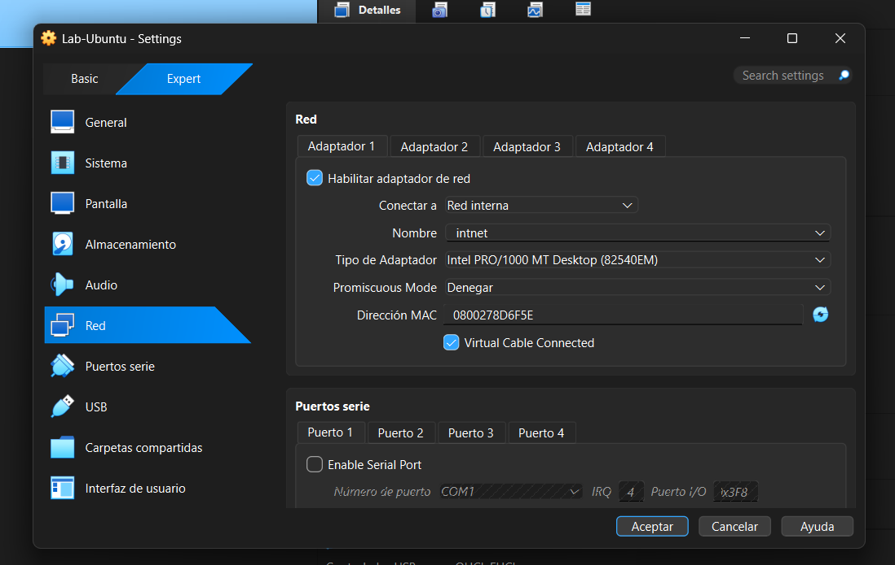
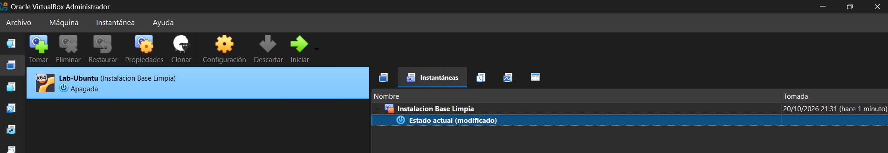

# Laboratorio virtual de ciberseguridad con Ubuntu

## 1. Objetivo

El objetivo de esta actividad fue crear un entorno virtual de pruebas utilizando VirtualBox y Ubuntu, aplicando medidas de aislamiento de red para realizar futuras prácticas de ciberseguridad de manera controlada, sin comprometer la computadora principal ni la red doméstica.

## 2. Configuración de la máquina virtual

Se utilizó Oracle VirtualBox para crear una máquina virtual con las siguientes características:

- **Nombre:** Lab-Ubuntu
- **Sistema operativo:** Ubuntu 24.04 LTS (64 bits)
- **Memoria RAM:** 2048 MB (2 GB)
- **Procesadores:** 2
- **Disco duro virtual:** 25 GB
- **Guest Additions:** instaladas
- **Modo de red inicial:** NAT
- **Modo de red final:** Red Interna

## 3. Configuración y justificación del aislamiento de red

Se seleccionó el modo **Red Interna** porque el objetivo de este laboratorio es contar con un entorno aislado, sin necesidad de acceder a Internet durante las pruebas iniciales.

Esta configuración permite que la máquina virtual se comunique únicamente con otras máquinas virtuales conectadas a la misma red interna, evitando la comunicación directa con la computadora anfitriona y la red doméstica.

No se utilizó el modo **Puente (Bridged)** porque este conecta la máquina virtual directamente a la red local, como si fuera otro dispositivo físico. Esto podría aumentar su exposición frente a otros equipos de la red.

Por lo tanto, se eligió Red Interna para reducir los riesgos y mantener un entorno de pruebas más controlado.

### Captura de la configuración de red

## 4. Creación de la instantánea (Snapshot)

Una vez instalado y configurado Ubuntu, se apagó la máquina virtual y se creó una instantánea llamada **Instalación Base Limpia**.

Esta instantánea permite conservar el estado inicial del sistema y restaurarlo si alguna prueba futura produce errores o modificaciones no deseadas, evitando tener que realizar nuevamente toda la instalación.

### Captura de la instantánea

## 5. Conclusión

La actividad permitió conocer el proceso de creación y configuración de una máquina virtual, comprender las diferencias entre los modos de red de VirtualBox y aplicar medidas básicas de aislamiento.

Además, la creación de una instantánea proporciona un punto de recuperación para realizar futuras prácticas de ciberseguridad de forma más segura y controlada.
